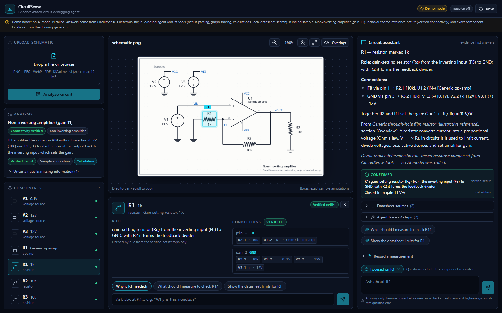
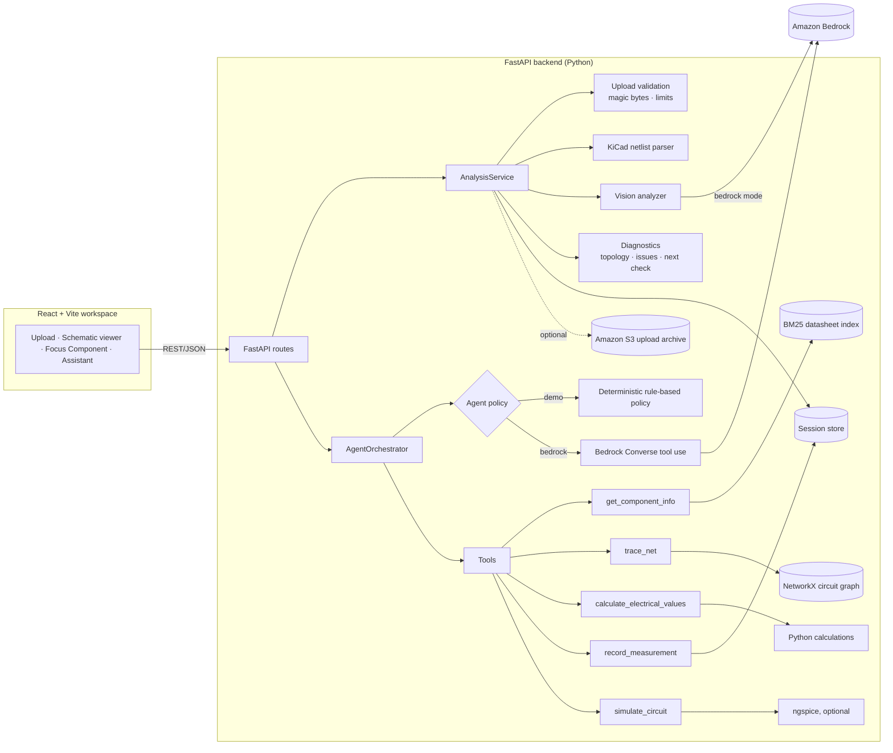

# CircuitSense

**An AI agent that understands, explains and debugs electronic circuits – with evidence.**

CircuitSense is for electronics students, hardware engineers and PCB designers. Upload a schematic image, a PDF or a KiCad netlist and ask questions such as *"How does this circuit work?"*, *"What is the purpose of R1?"*, *"Why might my output voltage be low?"* or *"What should I measure next?"*.

The core idea is **evidence-based circuit reasoning instead of image-based guessing**. Every fact CircuitSense shows is labelled with where it came from: a verified netlist, a vision-model inference, a deterministic calculation, a retrieved datasheet passage, a measurement you reported, or an actual simulation. Answers separate *confirmed findings* from *hypotheses*.



---

## Contents

- [Features](#features)
- [Architecture](#architecture)
- [Repository layout](#repository-layout)
- [Prerequisites](#prerequisites)
- [Local setup (Windows and Linux)](#local-setup)
- [Demo mode](#demo-mode)
- [Amazon Bedrock configuration](#amazon-bedrock-configuration)
- [API examples](#api-examples)
- [Testing](#testing)
- [Limitations](#limitations)
- [Deployment](#deployment)
- [Security and safety](#security-and-safety)

---

## Features

| Area | What works today |
| --- | --- |
| **Uploads** | PNG / JPEG / WebP images, PDFs (one page rendered and analysed, page selectable), KiCad netlists (`.net`). Images and PDFs can carry an optional netlist attachment. Types are detected from file content (magic bytes), not file names. Size, page-count and pixel limits apply. |
| **Netlist parsing** | KiCad netlist S-expressions (KiCad 5 "version D" and KiCad 6+ "version E"). Duplicate designators, unknown references, pins on two nets and truncated files are rejected with clear errors. This is the **only** source of *verified* connectivity. |
| **Circuit graph** | NetworkX graph of components, pins and nets. Trace a component, a pin (`U1.6` or `U1.OUT`) or a net, and find the verified path between two targets (for example the op-amp feedback path). |
| **Vision (Bedrock mode)** | A vision-capable Bedrock model reports components, visible values, bounding boxes and *inferred* connections through a strict tool schema. These are always labelled `image_inference`/`inferred` and are never treated as verified. |
| **Topology insight** | Rule-based recognition of LED indicators, resistor dividers and inverting/non-inverting op-amp stages; component roles; idealised DC operating-point estimate (modified nodal analysis); potential issues, each with evidence. |
| **Deterministic calculations** | Ohm's law, voltage divider (with optional load), LED series resistor, series and parallel resistance, inverting and non-inverting gain, RC time constant. Units are parsed (`4k7`, `330R`, `100nF`, `9.09 mA`) and validated, and assumptions are listed. |
| **Datasheet retrieval (RAG)** | BM25 keyword search over local Markdown, text and PDF files. Results are component-aware (boosted by component type and part number) and keep the source file, page and section. Illustrative teaching documents are flagged as such. |
| **Agent** | Tool-using loop with five tools (`get_component_info`, `trace_net`, `calculate_electrical_values`, `record_measurement`, `simulate_circuit`). It has bounded iterations, a per-step tool budget, a limit on tool failures, no identical retries, and guardrails that downgrade unsupported "confirmed" findings. Citations are built only from passages a tool actually returned. |
| **Measurements** | Record measurements through the API, the UI form, or by telling the agent (*"I measured 4.2 V at VCC"*). Values are converted to SI units and compared with the expected values, and the next check is re-planned. The agent cannot record a value that does not appear in your message. |
| **Simulation (optional)** | ngspice DC operating point, generated only from a verified netlist with supported parts. It runs without a shell, in a temporary directory, with a timeout. If ngspice is not installed, the tool says so; it never invents results. |
| **Workspace UI** | Three-panel engineering workspace: upload, samples, analysis and components on the left; schematic viewer with zoom, pan and exact overlays plus the **Focus Component** panel in the centre; the assistant with evidence, citations, the next diagnostic step and a measurement recorder on the right. On phones the panels become tabs. |
| **Focus Component** | Select a part in the list or on the schematic. You see its marked value, its role derived from verified topology, and its verified connections, and every following question carries that component as context. Ask "Why is this needed?" without retyping `R1`. |
| **Demo mode** | Works without AWS credentials. A deterministic, rule-based policy drives the same tools and every answer is labelled *"Demo mode – no AI model was called"*. |

### Reference circuits (fully tested)

| Sample | Netlist | Expected behaviour (asserted in tests) |
| --- | --- | --- |
| `led_basic` | 5 V source, R1 = 330 Ω, red LED D1 | I ≈ 9.09 mA (Vf = 2.0 V assumed), R1 drops 3 V and dissipates 27.3 mW |
| `resistor_divider` | 12 V, R1 = 10 kΩ, R2 = 4.7 kΩ, J1 output header | VOUT ≈ 3.84 V unloaded, 816 µA divider current |
| `noninverting_amp` | ±12 V rails, U1 generic op-amp, Rf = R2 = 10 kΩ, Rg = R1 = 1 kΩ, 10 kΩ load, 0.1 V input | Gain 11 (20.8 dB), VOUT ≈ 1.1 V, FB ≈ VIN |

Each sample has a drawn schematic (`schematic.png`; the LED sample also has `schematic.pdf`), a **hand-authored reference netlist in KiCad netlist format**, exact component annotations, expected behaviour, and test questions with expected answers (`circuit.json`). The connectivity of each netlist is validated against an independently written adjacency table in `backend/tests/test_circuit_core.py`. See [data/sample_circuits/README.md](data/sample_circuits/README.md).

---

## Architecture



**Request flow for a chat question:** the orchestrator builds the verified circuit graph and a topology insight, then asks the policy for the next turn. The policy either requests tools or submits a structured final answer (`submit_answer`: answer, confirmed findings with their basis, hypotheses, next step, follow-up questions and cited passage ids). Tools run with Pydantic-validated inputs. The orchestrator collects citations, calculations and measurements from the tool outputs, downgrades findings whose basis was not established, and returns a `ChatResponse` with a full tool trace.

Key design decisions:

- **Provenance is part of the schema.** `Net.verification == "verified"` is only allowed when `provenance == "parsed_netlist"`, and this is enforced by a Pydantic validator.
- **Python does the arithmetic.** The model is told to use `calculate_electrical_values`. Expected node voltages come from a small MNA solver that is labelled as an idealised calculation, not a simulation.
- **One orchestrator, two policies.** Demo and Bedrock share the tools, limits and guardrails, so demo mode exercises the real pipeline.
- **Extension points:** `SessionStore` (swap in DynamoDB or Redis), `RetrievalBackend` (swap in embeddings or Bedrock Knowledge Bases without changing the API), `NetlistParser` (add other formats) and `VisionAnalyzer`.

---

## Repository layout

```
.
├── backend/
│   ├── app/
│   │   ├── main.py                 # FastAPI app factory, CORS, body-size limit, optional SPA serving
│   │   ├── config.py               # Settings from environment / backend/.env
│   │   ├── api/                    # routes.py, errors.py (consistent {"error": {...}} bodies)
│   │   ├── schemas/                # circuit.py, chat.py, common.py (Pydantic contracts)
│   │   ├── services/
│   │   │   ├── circuit_parser.py   # KiCad netlist parser (S-expressions)
│   │   │   ├── circuit_graph.py    # NetworkX graph, trace, path finding
│   │   │   ├── dc_solver.py        # idealised DC operating point (MNA)
│   │   │   ├── diagnostics.py      # topology, roles, issues, next-check planner
│   │   │   ├── calculations.py     # deterministic electrical calculations
│   │   │   ├── units.py            # engineering-unit parsing/formatting
│   │   │   ├── retrieval_service.py# BM25 datasheet retrieval with attribution
│   │   │   ├── vision_service.py   # upload validation, image/PDF prep, Bedrock vision
│   │   │   ├── bedrock_service.py  # Converse wrapper, error mapping, model checks
│   │   │   ├── agent.py            # orchestrator + Bedrock policy
│   │   │   ├── demo_agent.py       # deterministic demo policy
│   │   │   ├── simulation_service.py # ngspice deck generation + sandboxed run
│   │   │   ├── analysis_service.py # builds CircuitAnalysis from uploads/samples
│   │   │   ├── storage.py          # SessionStore (in-memory) + optional S3 archive
│   │   │   └── container.py        # dependency wiring by configuration
│   │   └── tools/                  # agent tool definitions (base.py, circuit_tools.py)
│   ├── scripts/generate_sample_assets.py  # draws sample schematics + annotations + sample PDF
│   ├── tests/                      # pytest suite (no AWS needed)
│   ├── requirements.txt / requirements-dev.txt
│   └── .env.example
├── frontend/                       # React 19 + Vite 7 + TypeScript + Tailwind v4 + lucide-react
│   └── src/{App.tsx, components/, lib/, test/}
├── data/
│   ├── sample_circuits/            # led_basic, resistor_divider, noninverting_amp
│   └── sample_datasheets/          # illustrative reference docs (.md + one .pdf)
├── deploy/iam-task-policy.json     # least-privilege policy template
├── docs/                           # DEPLOYMENT.md, builder-center-article.md, screenshots/
├── Dockerfile                      # single container: API + built frontend
└── README.md
```

---

## Prerequisites

- **Python 3.11+** (developed with 3.11.2)
- **Node.js 20.19+ or 22.12+** (developed with 22.13) and npm
- Optional: **ngspice** on `PATH` (or `NGSPICE_PATH`) for real simulations
- Optional, for Bedrock mode: an AWS account with Amazon Bedrock model access, credentials in the standard AWS chain, and the AWS CLI

---

## Local setup

### Windows (PowerShell)

```powershell
# Backend
cd backend
python -m venv .venv
.\.venv\Scripts\Activate.ps1
pip install -r requirements-dev.txt
Copy-Item .env.example .env          # PROVIDER_MODE=demo by default
uvicorn app.main:app --reload --port 8000

# Frontend (second terminal)
cd frontend
npm install
npm run dev                           # http://localhost:5173 (proxies /api and /health to :8000)
```

### Linux / macOS (bash)

```bash
# Backend
cd backend
python3 -m venv .venv
source .venv/bin/activate
pip install -r requirements-dev.txt
cp .env.example .env
uvicorn app.main:app --reload --port 8000

# Frontend (second terminal)
cd frontend
npm install
npm run dev
```

Open <http://localhost:5173>. The interactive API docs are at <http://localhost:8000/docs>.

To serve everything from one process (as the container does), build the frontend and point the API at it:

```bash
cd frontend && npm run build && cd ../backend
FRONTEND_DIST=../frontend/dist uvicorn app.main:app --port 8000   # PowerShell: $env:FRONTEND_DIST="../frontend/dist"
```

---

## Demo mode

`PROVIDER_MODE=demo` is the default and needs no AWS credentials.

- **Reference circuits:** click a sample (or an example question on the start screen). You get the verified netlist, exact overlays and the full agent experience.
- **Agent answers:** produced by `DemoAgentPolicy`, which picks tools with explicit rules (explain, role, trace, feedback path, calculate, debug, datasheet, measurement, simulate) and composes the answer **only from tool outputs**. Every answer ends with *"Demo mode: deterministic rule-based response … no AI model was called"*, the UI shows a *Demo mode · rule-based* badge, and the API returns `"mode": "demo"`.
- **Uploading a sample file** (for example `data/sample_circuits/led_basic/schematic.png` or `schematic.pdf`) is recognised by an exact SHA-256 match. Its reference data is loaded, and a notice says so explicitly.
- **Uploading any other image:** demo mode does not interpret images. You get an honest *"Image analysis unavailable"* result with no components and no invented connectivity. Upload a KiCad netlist (alone or as an attachment) to get verified analysis.

Try this sequence on the LED sample: *Calculate current through the LED* → *The LED is dim. What should I measure next?* → *I measured 4.2 V at VCC*.

---

## Amazon Bedrock configuration

1. **Enable model access** in the Bedrock console for the region you will use. You need a text model that supports **tool use through the Converse API**, and a model that accepts **image input** for schematic reading (one model can do both).
2. **Find the exact IDs available to your account.** Many newer models must be called through a cross-region **inference profile** (IDs like `us.<provider>.<model>`):
   ```bash
   aws bedrock list-foundation-models --region us-east-1 \
     --query "modelSummaries[].[modelId,join(',',inputModalities)]" --output table
   aws bedrock list-inference-profiles --region us-east-1 \
     --query "inferenceProfileSummaries[].inferenceProfileId" --output table
   ```
3. **Configure** `backend/.env` (nothing is hardcoded):
   ```ini
   PROVIDER_MODE=bedrock
   AWS_REGION=us-east-1
   BEDROCK_TEXT_MODEL_ID=<model or inference-profile ID with tool use>
   BEDROCK_VISION_MODEL_ID=<model or inference-profile ID with IMAGE input>
   ```
   Credentials come from the standard AWS chain (environment variables, profile, SSO or IAM role). If `AWS_BEARER_TOKEN_BEDROCK` (a Bedrock API key) is set in your environment, it is used too. Expired keys produce a clear *Access denied* error that mentions this variable.
4. **Check compatibility and permissions before relying on the models:**
   ```bash
   curl "http://localhost:8000/api/provider/status"              # metadata checks (free)
   curl "http://localhost:8000/api/provider/status?probe=true"   # + a tiny Converse call (small cost)
   ```
   The status call verifies that each model or inference profile exists, reports its input modalities, and flags a vision model that cannot accept images.

Notes:

- `BEDROCK_TEMPERATURE` is not sent unless you set it, because several current models reject explicit sampling parameters.
- The agent uses `toolChoice: auto` and asks the model to finish by calling `submit_answer`. Models that reject forced tool choice still work, and a plain-text answer is accepted with a warning.
- If Bedrock mode is selected but misconfigured, `/health` reports `degraded` with the reasons, and `/api/chat` returns `503 provider_not_configured`. It never falls back to demo answers silently.

---

## API examples

All errors use one shape: `{"error": {"code": "...", "message": "...", "details": ...}}`.

```bash
# Health and provider mode
curl http://localhost:8000/health

# Bundled samples
curl http://localhost:8000/api/samples
curl -X POST http://localhost:8000/api/samples/led_basic/load

# Analyze an upload (image/PDF/netlist), optionally with a netlist attachment and a PDF page
curl -F "file=@data/sample_circuits/led_basic/schematic.pdf" -F "page=1" http://localhost:8000/api/circuits/analyze
curl -F "file=@my_board.png" -F "netlist=@my_board.net" http://localhost:8000/api/circuits/analyze

# Retrieve a session (analysis + chat history + measurements) and its preview image
curl http://localhost:8000/api/circuits/<circuit_id>
curl -o preview.png http://localhost:8000/api/circuits/<circuit_id>/preview

# Trace a component, a pin, a net, or the path between two targets
curl -X POST http://localhost:8000/api/circuits/<circuit_id>/trace \
  -H "Content-Type: application/json" -d '{"target": "U1.OUT", "to": "U1.IN-"}'

# Record a measurement
curl -X POST http://localhost:8000/api/circuits/<circuit_id>/measurements \
  -H "Content-Type: application/json" \
  -d '{"quantity": "voltage", "value": 3.1, "unit": "V", "target": "VOUT", "reference": "GND", "power_state": "powered"}'

# Ask the agent (optionally focused on a component)
curl -X POST http://localhost:8000/api/chat -H "Content-Type: application/json" \
  -d '{"circuit_id": "<circuit_id>", "message": "Why is this resistor needed?", "focus_component": "R1"}'
```

A chat response contains `answer`, `confirmed[]` and `hypotheses[]` (each with a `basis`), `next_step` (action, reason, expected reading, safety note), `citations[]` (source file, page, section, excerpt, `illustrative`), `calculations[]`, `measurements_recorded[]`, `tool_calls[]` (name, input, status, summary, duration), `iterations`, `stopped_reason`, `mode` and `warnings[]`.

---

## Testing

```bash
# Backend: 121 tests, deterministic, no AWS access needed (Bedrock is exercised with fake clients)
cd backend && python -m pytest -q

# Frontend: type check, unit/integration tests (Vitest + Testing Library), production build
cd frontend
npm run typecheck
npm test
npm run build
```

What is covered:

- **Backend:** health and provider configuration; invalid, empty, oversized, corrupt and misleadingly named uploads; PDF page handling; component, bounding-box, net and measurement schema validation; reference-netlist connectivity against independently written expectations; KiCad 5 and 6+ parsing and error cases; graph traversal and feedback-path finding; Ohm's law and the other calculations; the DC estimate (including a reversed LED); topology classification; issue evidence; next-check planning; missing or inferred connectivity; datasheet retrieval with source and page attribution; agent iteration, budget and failure limits; finding downgrades and citation filtering; refusal of fabricated measurements; the Bedrock tool loop (message structure, reasoning blocks replayed, untrusted text delimited, error mapping); vision report validation; model checks; the SPICE deck generator, output parser and sandboxed runner; S3 archiving; static file serving without path traversal; and every sample test question in demo mode.
- **Frontend:** loading state, API-offline error, upload error, component selection with verified connections and focus context sent to the chat, hypotheses vs. next step, overlays disabled without coordinates, chat error, and the Markdown renderer refusing raw HTML.

**Frontend test fixtures:** `frontend/src/test/fixtures.json` contains real responses captured from the backend in demo mode, so the UI tests use the exact API shapes. Regenerate them after schema changes with `cd backend && python -m scripts.export_frontend_fixtures`.

**Sample assets:** `cd backend && python -m scripts.generate_sample_assets` redraws the sample schematics, their exact annotations and the sample PDFs deterministically.

---

## Limitations

- **Sessions are in memory.** They are lost on restart and not shared between processes or containers, so run a single worker or replica until a persistent `SessionStore` is added. The store is bounded (LRU, `SESSION_MAX_COUNT`).
- **Demo mode does not read images.** Only bundled sample files (exact byte match), netlists and the reference circuits get full analysis.
- **Image interpretation (Bedrock mode) is unverified by nature.** Bounding boxes and connections from a vision model can be wrong. They are labelled as such and never used for verified tracing.
- **Live Bedrock calls were not exercised in this environment.** The development machine's Bedrock API key had expired, so the Bedrock path is covered by tests with fake boto3 clients that follow the Converse request and response format. Run `/api/provider/status?probe=true` and a chat in your own account to validate end to end.
- **ngspice integration was not run against a real binary here** (ngspice is not installed on the development machine). Deck generation, the sandboxed runner, timeouts and output parsing are unit-tested with mocks; the output parser fixture is synthetic.
- **Topology templates** cover LED indicators, dividers and single op-amp gain stages. Other circuits still get verified tracing, calculations, retrieval and generic roles, but no topology-specific planner.
- **The DC estimate** uses idealised models: constant LED Vf of 2.0 V (illustrative), op-amps without rail limits, capacitors open. Its assumptions are always shown.
- **Datasheets are illustrative teaching documents,** not manufacturer specifications, and are flagged `illustrative` everywhere they appear. Add real vendor PDFs to `data/sample_datasheets/` (or point `DATASHEET_DIR` elsewhere) to use your own.
- **Only one PDF page** is analysed per upload (`page` selects which one).
- **No authentication.** Put the app behind your own auth (for example an ALB with Cognito/OIDC) before exposing it.

---

## Deployment

[docs/DEPLOYMENT.md](docs/DEPLOYMENT.md) gives a step-by-step container deployment (Amazon ECR → Amazon ECS on AWS Fargate behind an Application Load Balancer) with:

- required environment variables,
- a least-privilege IAM task policy ([deploy/iam-task-policy.json](deploy/iam-task-policy.json)),
- Bedrock model-access prerequisites,
- frontend/backend configuration,
- the optional S3 upload archive,
- smoke tests,
- cost considerations and cleanup.

It also explains why AWS Lambda is not recommended for this MVP as built. **Nothing has been deployed as part of this repository.**

---

## Security and safety

- AWS credentials are never sent to or embedded in the frontend; the browser only talks to the CircuitSense API.
- Only `.env.example` is committed. `.env` is git-ignored.
- Uploads are identified by content, are size-, page- and pixel-limited, are decoded with decompression-bomb protection, and are re-encoded as PNG for preview. Uploaded filenames never become filesystem paths, and S3 keys are sanitised.
- Simulation runs only on decks generated from verified netlists. Values are parsed to numbers and names are sanitised; ngspice runs without a shell, in a temp directory, with a timeout. User-supplied commands are never executed.
- Uploaded content and vision-model output are treated as **untrusted data**. They are wrapped in `<untrusted>` delimiters in prompts, and the system prompt instructs the model to ignore instructions inside them.
- Hardware advice is advisory. Every next step carries a safety note. Circuits with sources of 50 V or more trigger a hazardous-voltage warning, resistance checks always say to remove power first, and the UI footer repeats the guidance.
